# KAVACH

**A kernel-native firewall for the agentic, encrypted, zero-trust era.**

C for the fast path · Rust for everything that parses · one portable core for every Unix

[](https://github.com/Srizdebnath/kavach/actions/workflows/ci.yml)
[](https://github.com/Srizdebnath/kavach/releases)
[](https://scorecard.dev/viewer/?uri=github.com/Srizdebnath/kavach)
%20%7C%20Apache--2.0%20OR%20MIT-blue)

[](CONTRIBUTING.md)

`eBPF / XDP fast path` · `BPF-LSM identity egress` · `Identity > IP` · `Policy-as-code` ·
`Signed bundles` · `Hot-swap in µs, no reboot` · `Memory-safe parsers` · `No admin portal`

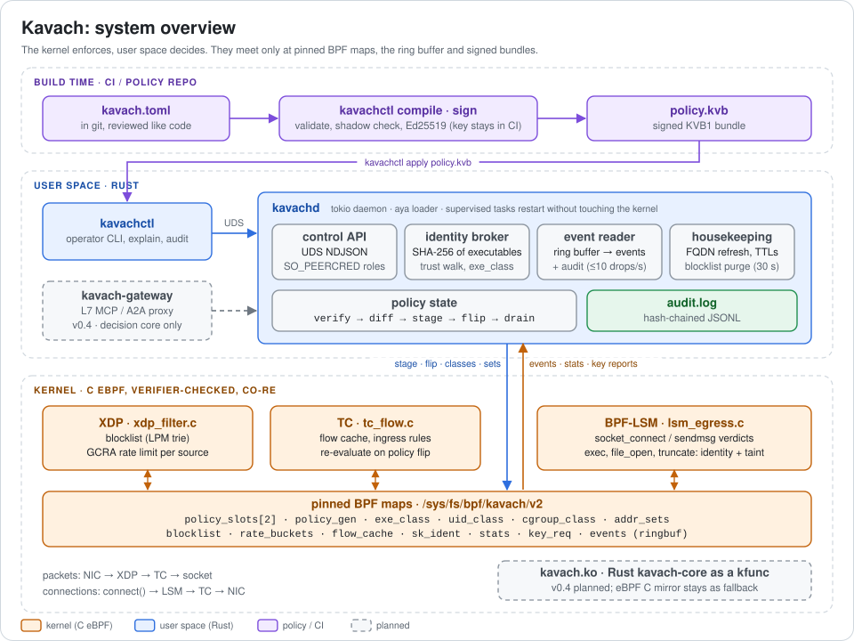

---

## Contents

1. [Why Kavach](#why-kavach)
2. [How it works](#how-it-works) (diagrams)
3. [Known gaps of modern firewalls, and how Kavach handles them](#known-gaps-of-modern-firewalls-and-how-kavach-handles-them)
4. [Benchmarks](#benchmarks)
5. [Test results and quality gates](#test-results-and-quality-gates)
6. [Setup guide](#setup-guide)
7. [Writing policy](#writing-policy)
8. [Operating it](#operating-it)
9. [Building from source](#building-from-source)
10. [Status and roadmap](#status-and-roadmap)
11. [Contributing](#contributing)
12. [Security](#security)
13. [License](#license)

---

## Why Kavach

Firewalls in 2026 are themselves the attack surface (parser CVEs, internet-facing admin
portals), are blind to encrypted traffic, think in IP addresses while workloads change IPs every
minute, and still need maintenance windows to apply a rule. Kavach fixes this from the host up:

| | Kavach | Typical host firewall (iptables / nftables) | Typical perimeter NGFW |
|---|---|---|---|
| Where it decides | in the kernel: XDP (before `sk_buff`), TC, BPF-LSM | netfilter hooks | a separate box |
| Who a rule targets | **executable SHA-256**, path, uid, cgroup, CIDR, port | IP, port (owner match: uid/gid, output only) | IP, zone, user via directory |
| Encrypted traffic | knows *which process* opened the socket; no MITM | blind | MITM / decryption |
| Policy changes | signed bundle, **atomic A/B flip in < 1 ms** | rule reload | commit + push window |
| Policy source | `kavach.toml` in git, validated + shadow-checked + signed | shell scripts / ruleset files | web UI |
| Management surface | local Unix socket with `SO_PEERCRED`; **nothing listens on the network** | local | HTTPS admin portal |
| Parsers of untrusted bytes | Rust, `no_std`, `forbid(unsafe)`, fuzzed | C | C/C++ |
| Daemon crash | kernel keeps enforcing the last policy | n/a | box down = network down or open |

* **Kernel-native.** XDP drops known-bad traffic before an `sk_buff` exists. TC tracks flows in
  O(1). BPF-LSM attributes every `connect()`/`sendmsg()` to the process that made it.
* **Identity, not IP.** Rules target a binary's SHA-256, its path, the user, or the cgroup. A
  write to a trusted binary revokes its trust *in the kernel* before the write lands.
* **Policy as code.** `kavach.toml` → validated, shadow-checked, compiled, **ed25519-signed**
  bundle → atomic A/B hot-swap. No reboot, no reload, no half-applied policy.
* **Memory-safe where it matters.** *If it parses untrusted input, it is Rust.* C exists only in
  verifier-checked eBPF programs.

## How it works

Every diagram below is a hand-written SVG in [`diagrams/svg/`](diagrams/svg/) that follows the
code as built. Dashed outlines mean "designed, not built yet".

### Packet and connection paths

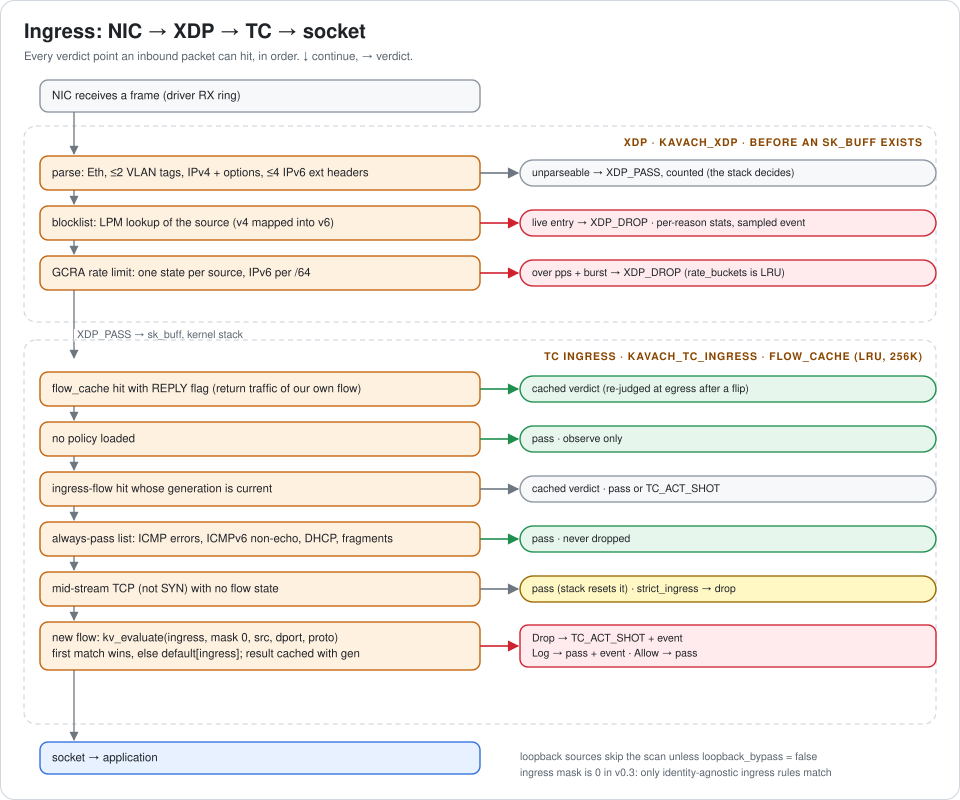
*Every verdict point an inbound packet can hit: XDP blocklist and GCRA rate limit before an
`sk_buff` exists, then the TC flow cache, always-pass list and ingress rules.*

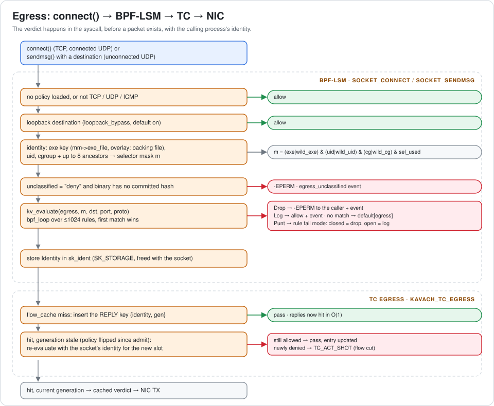
*Outbound connections are judged inside `connect()`/`sendmsg()` with the caller's identity
mask; TC egress re-evaluates established flows after a policy flip.*

### Identity

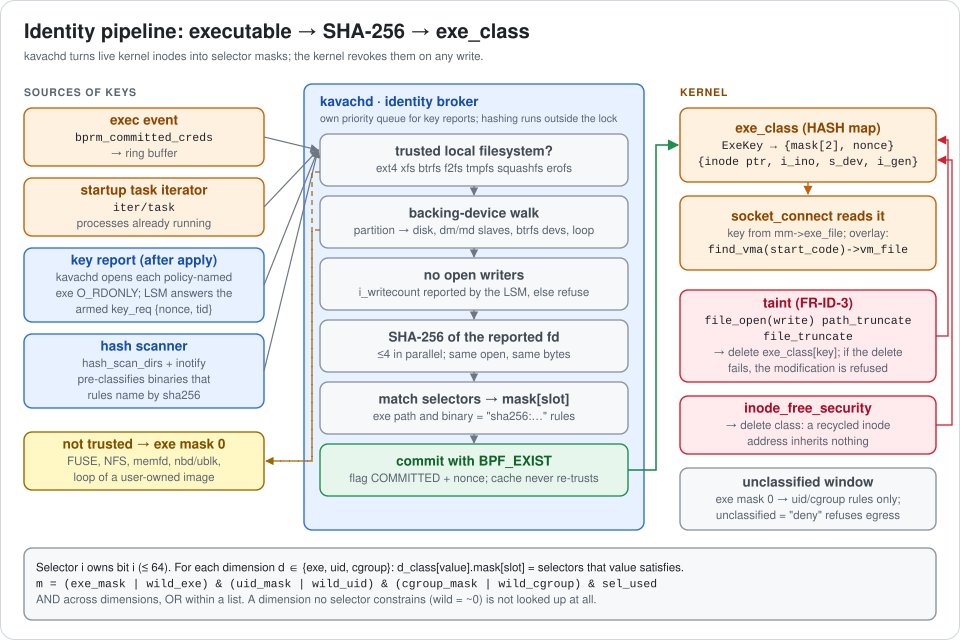
*How executables become selector masks: key sources, trusted-filesystem and backing-device
checks, SHA-256, commit into `exe_class`, and in-kernel taint revocation.*

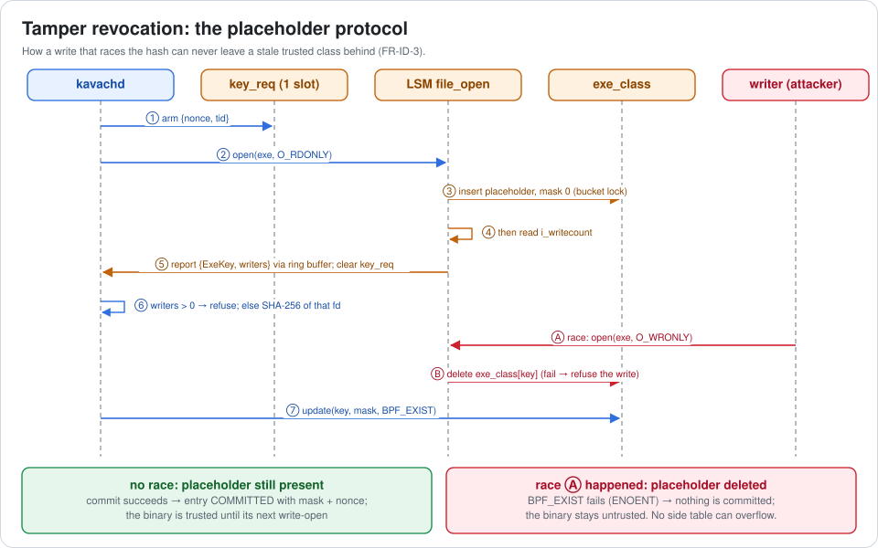
*Why a write that races the hash can never leave a binary trusted: the placeholder is deleted,
so the `BPF_EXIST` commit fails.*

### Policy as code

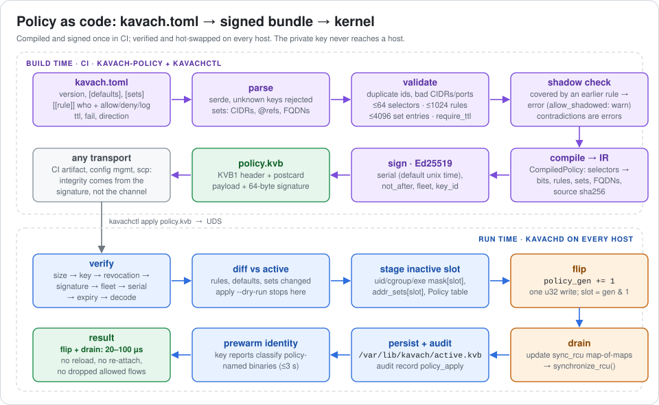
*`kavach.toml` is validated, shadow-checked, compiled and Ed25519-signed in CI; every host
verifies it, then stages, flips and drains.*

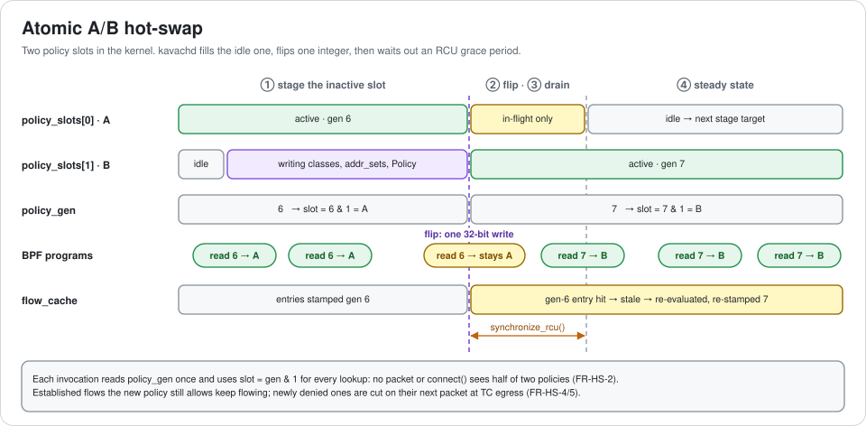
*Two policy slots and one 32-bit generation flip: no packet ever sees half of two policies, and
established flows that are still allowed survive.*

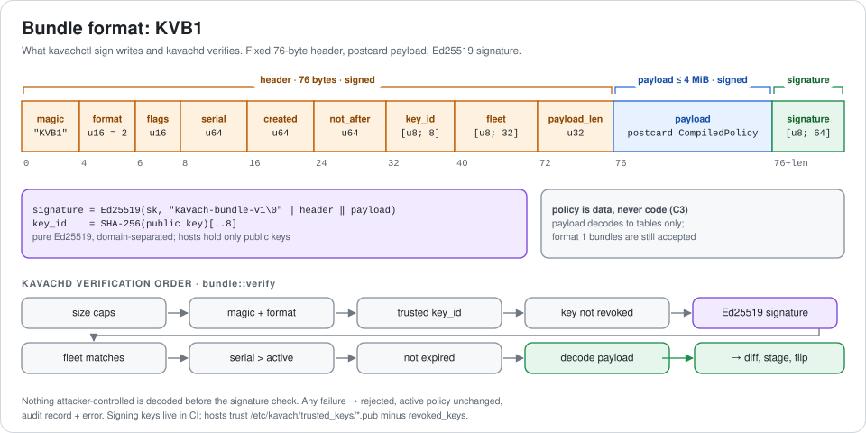
*The KVB1 layout, what the signature covers, and the order kavachd verifies it in; nothing is
decoded before the signature check.*

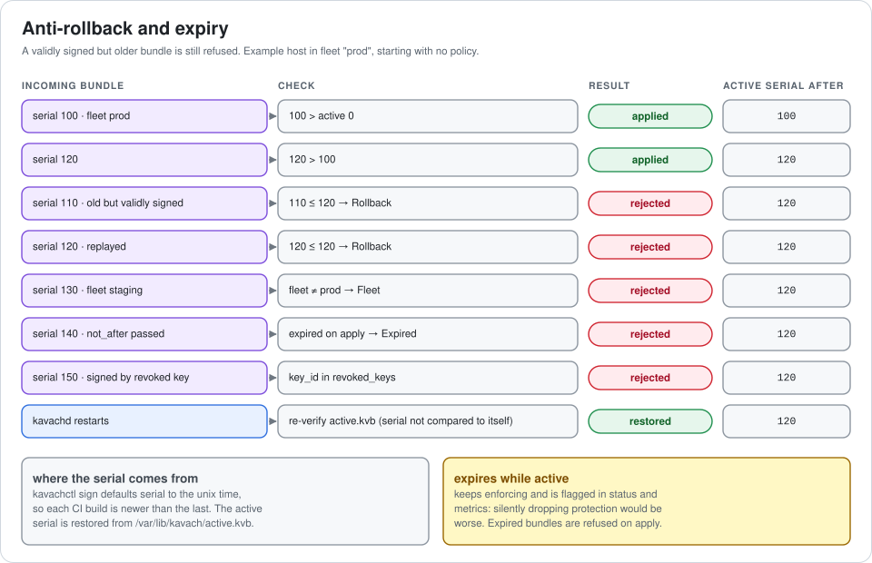
*A validly signed but older, replayed, wrong-fleet, expired or revoked-key bundle is refused.*

### Control plane, audit, failure and upgrade

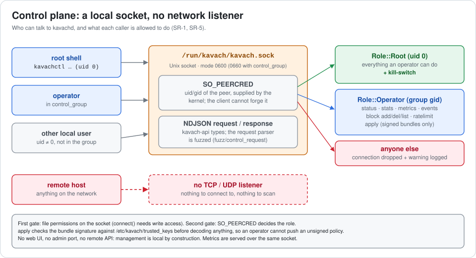
*No network listener: a 0600/0660 Unix socket with `SO_PEERCRED` roles; only root can trigger
the kill-switch.*

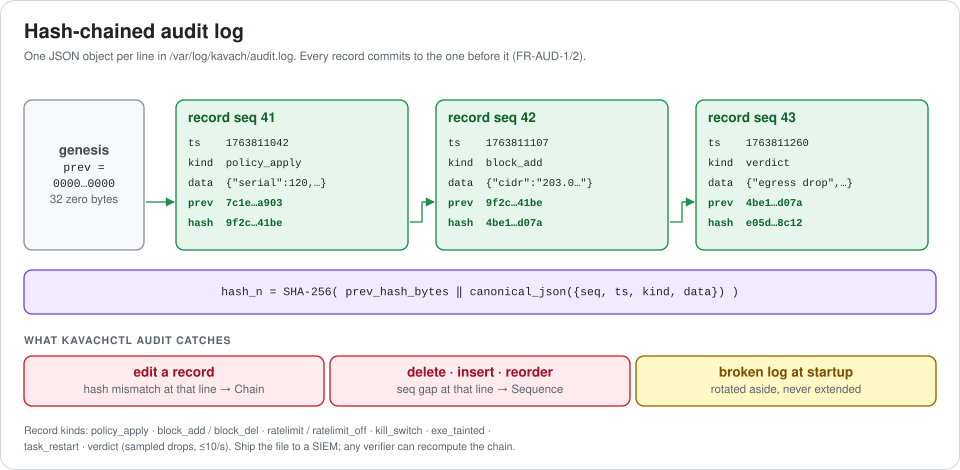
*Every change is appended to a hash-chained JSONL log; any edit, deletion or reordering breaks
the chain at that line.*

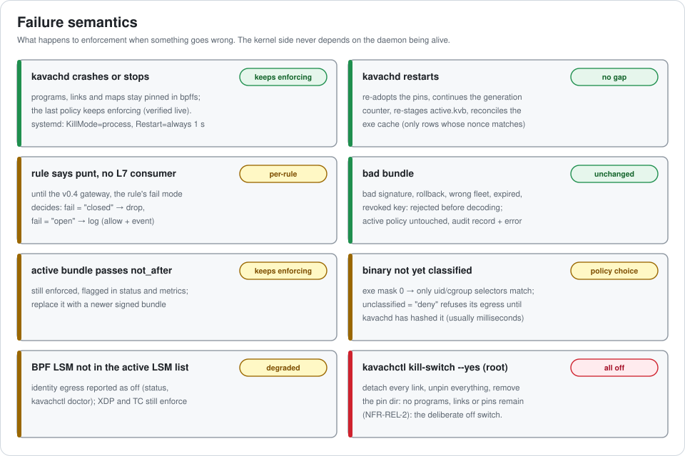
*What happens to enforcement on a daemon crash or restart, a punt with no consumer, a bad
bundle, a missing BPF LSM, or the kill-switch.*

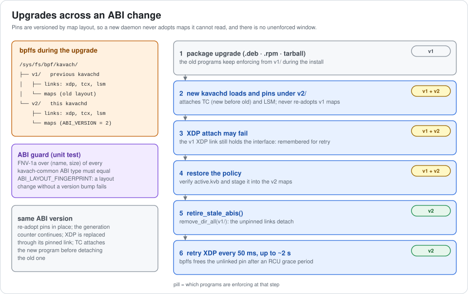
*Pins are versioned by ABI (`/sys/fs/bpf/kavach/v<ABI>`): the new daemon takes over before the
old version's pins are retired, so enforcement never stops.*

### Code

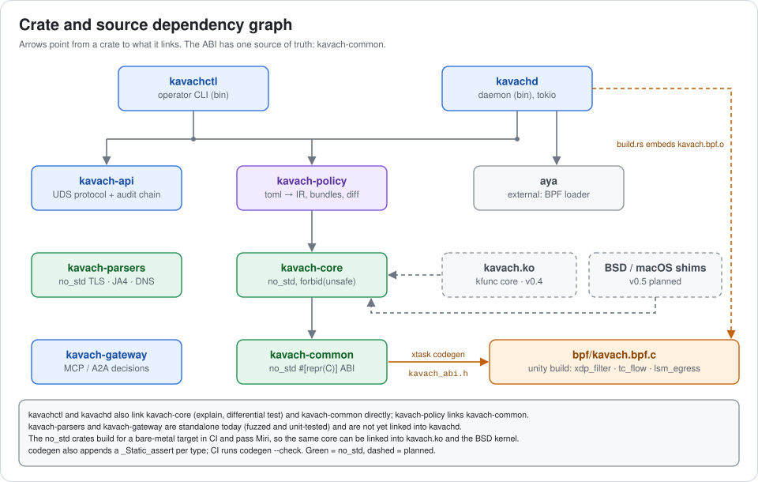
*Rust crates and the generated C ABI header; `kavach-common` is the single source of truth for
every shared layout.*

| Component | Language | Role |
|---|---|---|
| `bpf/xdp_filter.c` | C (eBPF) | LPM blocklist (v4/v6/VLAN), per-source GCRA rate limit (IPv6 per /64) |
| `bpf/tc_flow.c` | C (eBPF) | flow cache, reply tracking, ingress rules, re-evaluation on policy flip |
| `bpf/lsm_egress.c` | C (eBPF) | `socket_connect`/`sendmsg` verdicts, exec + write-taint tracking |
| `kavach-common` | Rust `no_std` | `#[repr(C)]` ABI, generates `kavach_abi.h` |
| `kavach-core` | Rust `no_std`, `forbid(unsafe)` | reference evaluator, differentially tested against the kernel |
| `kavach-policy` | Rust | `kavach.toml` → IR → tables; KVB1 bundles, ed25519, diff, explain |
| `kavach-parsers` | Rust `no_std`, `forbid(unsafe)` | TLS ClientHello (SNI/ALPN), JA4, DNS, QUIC v1/v2 Initial decryption |
| `kavach-api` | Rust | NDJSON control protocol over UDS, hash-chained audit log |
| `kavachd` | Rust (tokio + aya) | loader, identity broker, apply/A-B swap, anomaly engine, supervisor |
| `kavachctl` | Rust | CLI: compile, sign, apply, explain, events, stats, `top` TUI, doctor |
| `kavach-gateway` | Rust | v0.4 MCP / A2A tool-policy core; opt-in AF_XDP RX backend (zero-copy → copy → SKB fallback, watchdog) |

Deep dive: [Architecture](docs/ARCHITECTURE.md) · [Requirements (SRS)](docs/SRS.md) ·
[Roadmap diagram](diagrams/svg/15-roadmap.svg)

## Known gaps of modern firewalls, and how Kavach handles them

| # | Gap | Kavach's answer | State |
|---|---|---|---|
| G1 | The firewall itself is the target (parser CVEs, exposed admin portals) | Rust for every byte parser; no web UI; local UDS only; verifier-checked fast path; fuzzing | ✅ built |
| G2 | Encrypted traffic is opaque (TLS 1.3, ECH, QUIC) | Decide on *process identity* + destination at `connect()`; no MITM. TLS/JA4/DNS/QUIC parsers ready | ✅ identity · 🧩 parsers are a library |
| G3 | AI agents speak MCP / A2A / WebSockets | Punt verdict + MCP/A2A tool-policy core | 🧪 v0.4 |
| G4 | East-west traffic is invisible | Every host enforces; ingress deny-by-default for new flows; one signed fleet policy | ✅ built |
| G5 | IPs are not identity | Rules on binary SHA-256, path, uid, cgroup, k8s labels, SPIFFE ID; tamper revokes trust in-kernel | ✅ built (k8s/SPIFFE: v0.4 node agent) |
| G6 | Rule sprawl and misconfiguration | Hard validation, shadowed-rule errors, TTLs, `diff`, `--dry-run`, `explain` | ✅ built |
| G7 | Exploited within hours of disclosure | `block add` in seconds, policy hot-swap in < 1 ms, signed releases | ✅ built |
| G8 | Kernel modules can crash the box | Verified eBPF only, differential tests, clean unload, survives daemon crash | ✅ built |

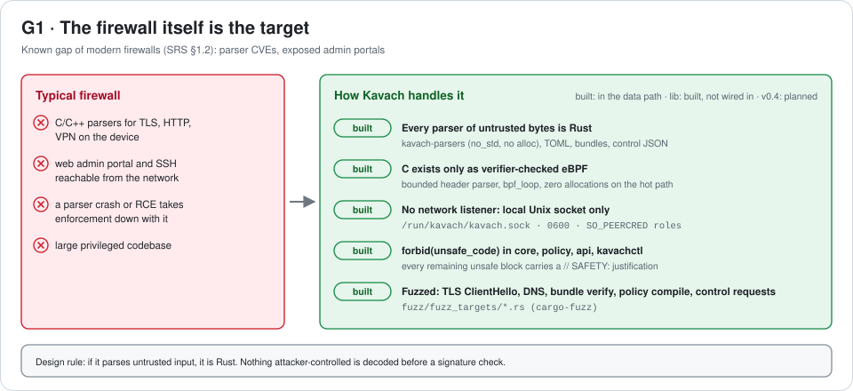
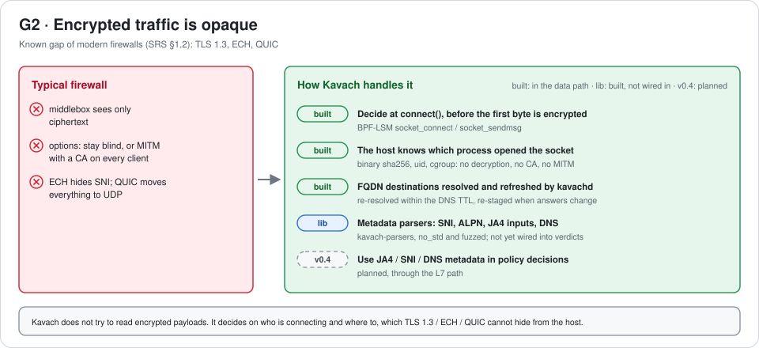
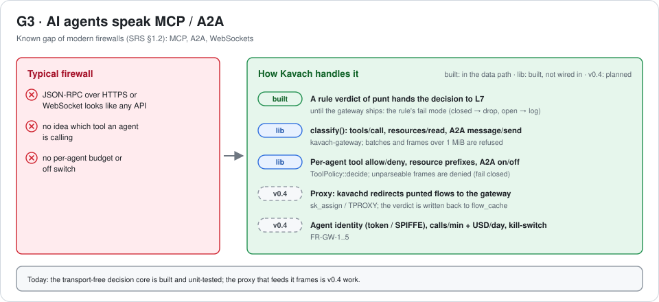
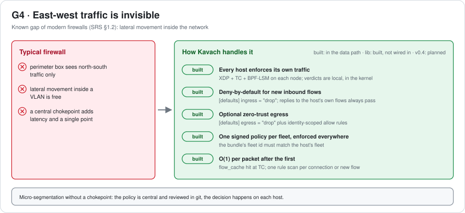
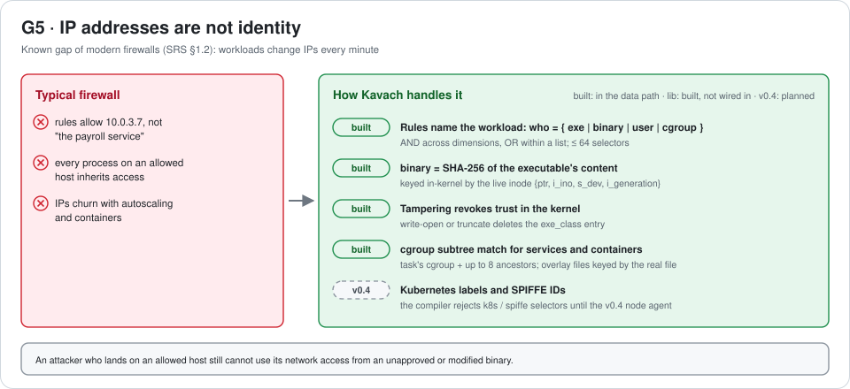
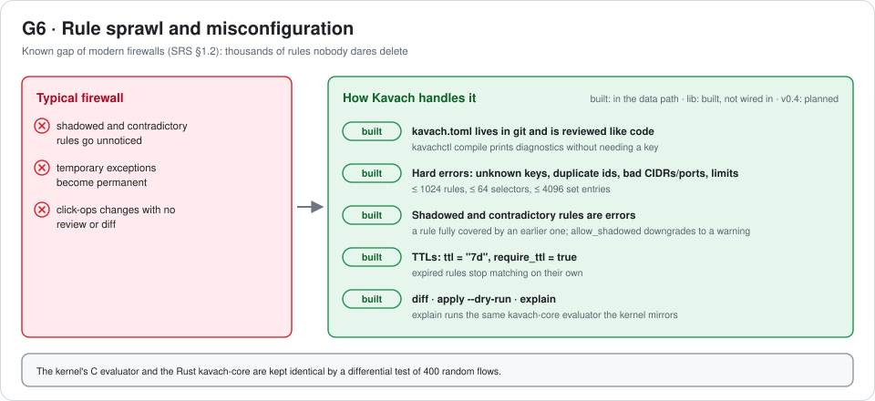
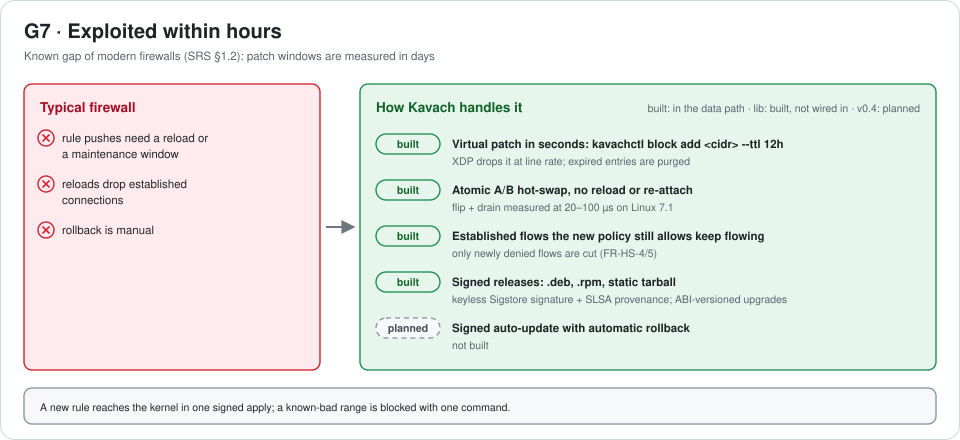
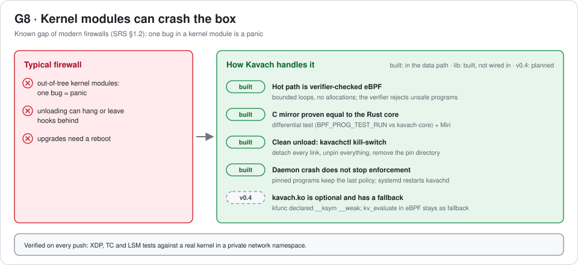

## Benchmarks

Measured on a real kernel by the `bench_report` test in
[`crates/kavachd/tests/bpf.rs`](crates/kavachd/tests/bpf.rs). Per-packet numbers are the
kernel's own `BPF_PROG_TEST_RUN` average over 200 000 runs (best of 5). Raw data:
[`docs/bench/`](docs/bench/).

Host: Intel Core i3-1115G4 (a 2-core laptop CPU), Linux 7.1.9, shipped defaults (blocklist
on, events sampled 1-in-64).

| What | Result |
|---|---|
| XDP, packet passes, empty blocklist | **33 ns** |
| XDP, packet dropped by a 10 000-entry LPM blocklist | **61 ns** |
| XDP, packet passes a 10 000-entry blocklist | **66 ns** |
| XDP, blocklist + per-source rate limit | **108 ns** |
| TC ingress, 1 000-rule policy, cached flow | **79 ns** |
| TC egress | **82 ns** |
| `connect()` syscall, no LSM → with BPF-LSM and 1 000 rules | 528 ns → 601 ns (**+73 ns**) |
| Policy apply (verify-staged A/B swap), 10 / 100 / 1 000 rules | 378 µs / 930 µs / 742 µs |

What these mean: at ~60–110 ns per packet a single core makes a verdict for roughly
9–16 million packets per second in XDP. Identity-aware egress costs about 73 ns per
`connect()`, which is small next to the syscall itself. A policy change for a whole host
lands in under a millisecond, with no reload and no dropped connections.

Verifier cost (instructions processed, deterministic per kernel):

| Program | Insns | Program | Insns |
|---|---|---|---|
| `kavach_xdp` | 7 064 (incl. AF_XDP step) | `kavach_connect` | 3 515 |
| `kavach_tc_ingress` | 5 078 | `kavach_sendmsg` | 3 530 |
| `kavach_tc_egress` | 6 601 | `kavach_exec` / `file_open` | 365 / 515 |

CI runs the same benchmark on every push and fails if anything exceeds
[`docs/bench/budget.json`](docs/bench/budget.json) (`scripts/perf-gate.py`).

Reproduce:

```sh
cargo test -p kavachd --test bpf --no-run
sudo env KAVACH_BENCH_OUT=$PWD/bench.json target/debug/deps/bpf-<hash> --ignored bench_report
scripts/perf-gate.py bench.json
```

## Test results and quality gates

Latest local run (same commands as CI):

| Suite | Result |
|---|---|
| Unit + property tests (`cargo test --workspace`) | **129 passed, 0 failed** |
| Real-kernel suite (`scripts/priv-test.sh`, root) | **14 passed, 0 failed** |
| Lint (`cargo fmt --check`, `clippy -D warnings`), `codegen --check` | clean |
| `cargo deny` (advisories, bans, licenses, sources) | ok |
| Miri (`kavach-common`, `kavach-core`, `kavach-parsers`) | runs in CI |
| Fuzz targets (`cargo fuzz`) | 6: TLS ClientHello, DNS, QUIC Initial, policy compile, bundle verify, control request |

The real-kernel suite loads the actual BPF objects through the verifier and drives them:

| Test | Proves |
|---|---|
| `xdp_blocklist_v4_v6_vlan` | v4, v6 and VLAN-tagged frames hit the LPM blocklist |
| `xdp_blocklist_expiry` | TTL'd blocks stop matching on time |
| `xdp_gcra_rate_limit_and_v6_slash64` | rate limit is per source, IPv6 per /64 |
| `xdp_malformed_frames_pass` | truncated/garbage frames never crash or drop by accident |
| `tc_ingress_rules_and_always_pass` | ingress rules, reply tracking, always-pass list |
| `differential_tc_ingress_vs_core` | kernel C and Rust `kavach-core` agree on random policies + packets |
| `hot_swap_reevaluates_cached_flows` | A/B flip re-judges cached flows |
| `lsm_identity_egress_end_to_end` | `curl` blocked for binary X, allowed for binary Y |
| `lsm_strict_mode_refuses_unclassified_until_hashed` | strict identity mode has no first-run window |
| `lsm_overlay_executables_use_the_real_file` | container (overlayfs) binaries keyed by their real file |
| `netns_veth_real_traffic_xdp_and_tc` | real traffic over a veth pair in a private netns |
| `xdp_afxdp_redirect_is_gated_by_flag_port_and_deadline` | AF_XDP redirect only for opted-in ports with a live consumer |
| `netns_veth_afxdp_redirect_and_watchdog` | real AF_XDP socket; a hung consumer falls back to the kernel stack; SSH/ping unaffected |
| `bench_report` | the benchmark above |

Kernel matrix ([`kernels.yml`](.github/workflows/kernels.yml), virtme-ng, prebuilt mainline
kernels, BPF-LSM on), all **14/14**:

| 6.1.192 (TC via legacy clsact) | 6.6.162 (tcx) | 6.12.118 (tcx) | 7.1.9 (host) | 7.3.5 (tcx) |
|---|---|---|---|---|
| ✅ | ✅ | ✅ | ✅ | ✅ |

Plus: install tests of the `.deb`,
`.rpm` and tarball in real containers, and every release is signed with Sigstore and carries
SLSA build provenance.

## Setup guide

The full guide with every option is in [docs/INSTALL.md](docs/INSTALL.md). This is the path
most people need.

### 1. Check your host

| Need | Check |
|---|---|
| Linux ≥ 6.1, x86_64 or aarch64 | `uname -r` |
| BTF | `ls /sys/kernel/btf/vmlinux` (default on Debian 11+, Ubuntu 20.10+, Fedora 31+, RHEL 8.2+, Arch) |
| bpffs | `mount | grep /sys/fs/bpf` (systemd mounts it) |
| cgroup v2 | `ls /sys/fs/cgroup/cgroup.controllers` |
| BPF LSM *(identity egress only)* | `cat /sys/kernel/security/lsm` contains `bpf` |

Release binaries are static (musl), with no runtime library dependencies.

### 2. Download and verify

Pick the asset for your distro from [Releases](https://github.com/Srizdebnath/kavach/releases):
`.deb` (Debian/Ubuntu), `.rpm` (Fedora/RHEL/openSUSE), or the `linux-musl.tar.gz` (any distro).

```sh
gh attestation verify kavach_0.3.1-1_amd64.deb --repo Srizdebnath/kavach   # SLSA provenance
cosign verify-blob SHA256SUMS --bundle SHA256SUMS.sigstore.json \
  --certificate-oidc-issuer https://token.actions.githubusercontent.com \
  --certificate-identity-regexp '^https://github\.com/Srizdebnath/kavach/\.github/workflows/release\.yml@refs/tags/v'
sha256sum --check --ignore-missing SHA256SUMS
```

### 3. Install

```sh
sudo apt install ./kavach_0.3.1-1_amd64.deb            # Debian / Ubuntu
sudo dnf install ./kavach-0.3.1-1.x86_64.rpm           # Fedora / RHEL (zypper on openSUSE)
tar xzf kavach-0.3.1-x86_64-linux-musl.tar.gz && cd kavach-0.3.1-x86_64-linux-musl \
  && sudo ./install.sh                                 # any distro
```

This installs `kavachd`, `kavachctl`, `kavachd.service` (**not** enabled or started) and
`/etc/kavach/kavachd.toml`. Then:

```sh
kavachctl doctor        # checks every requirement and prints the exact fix for each miss
```

### 4. Enable the BPF LSM (for per-executable rules)

Append `bpf` to the end of your current LSM list on the kernel command line, keeping everything
already there:

```sh
cat /sys/kernel/security/lsm   # e.g. lockdown,capability,landlock,yama,apparmor
# GRUB: in /etc/default/grub
GRUB_CMDLINE_LINUX="... lsm=lockdown,capability,landlock,yama,apparmor,bpf"
sudo update-grub             # Debian/Ubuntu;  Fedora/RHEL: sudo grub2-mkconfig -o /boot/grub2/grub.cfg
sudo reboot
```

No LSM? Set `lsm = false` in `/etc/kavach/kavachd.toml`; XDP and TC still enforce.

Running kavachd in a container? It needs `--privileged --pid=host` (BPF reports host PIDs).
Without the host PID namespace it refuses to attach the LSM and says so; `doctor` checks this.

### 5. Configure the host

`/etc/kavach/kavachd.toml` (defaults shown):

```toml
interfaces = ["auto"]     # interfaces with a default route, or e.g. ["eth0"]
xdp_mode   = "auto"       # auto | native | generic
tc         = true
lsm        = true
trusted_keys_dir = "/etc/kavach/trusted_keys"
fleet      = "default"
sample_rate = 64          # 1-in-N verdict events
# control_group = "kavach"  # let a group run read/operate commands

[ratelimit]
pps   = 20000
burst = 40000

[anomaly]                 # detection only, never blocks
enabled = true
```

### 6. Create a signing key and your first policy

Keep the private key on your admin/CI machine, never on the host:

```sh
kavachctl keygen ci                                    # ci.key (secret) + ci.pub
sudo install -m 0644 ci.pub /etc/kavach/trusted_keys/  # on every host
```

Write `kavach.toml` (start in observe mode):

```toml
version = 1

[defaults]
egress  = "allow"   # observe first; switch to "drop" when the counters look right
ingress = "drop"    # new inbound only; replies to our own flows always pass
fail    = "closed"

[sets]
ssh_admins = ["10.0.0.0/8"]

[[rule]]
id        = "ssh-from-admins"
direction = "ingress"
allow     = { from = "@ssh_admins", port = 22, proto = "tcp" }

[[rule]]
id      = "curl-not-to-testnet"
who     = { exe = "/usr/bin/curl" }     # or binary = "sha256:<hex>"
deny    = { to = "198.51.100.0/24" }
```

Compile, preview, sign:

```sh
kavachctl compile kavach.toml
kavachctl explain --policy kavach.toml --to 198.51.100.7 --port 443 --binary /usr/bin/curl
kavachctl sign kavach.toml --key ci.key -o policy.kvb --fleet default
```

### 7. Start and enforce

```sh
sudo systemctl enable --now kavachd
sudo kavachctl status
sudo kavachctl apply policy.kvb --dry-run   # diff against what is running
sudo kavachctl apply policy.kvb             # atomic swap, reported in µs
sudo kavachctl top                          # live dashboard
```

Rollout: run with `egress = "allow"` for a day while watching `stats`/`events`/`top`, `explain`
anything surprising, then switch to `egress = "drop"` (and `unclassified = "deny"` for strict
identity). The last bundle is restored at boot before the network comes up.

### 8. Uninstall

`sudo apt remove kavach`, `sudo dnf remove kavach`, or `sudo ./install.sh --uninstall`. Each
stops the service and runs the kill-switch, which detaches every program even when the daemon is
already stopped. Config, state and logs are kept.

## Writing policy

| Field | Meaning |
|---|---|
| `direction` | `ingress` or `egress` (default egress) |
| `allow` / `deny` / `log` | the verdict, with `{ to \| from, port, proto }` |
| `who` | `{ exe = "/path" }`, `{ binary = "sha256:…" }`, `{ user = "svc-pay" }` (name or uid), `{ cgroup = "/system.slice/x.service" }`, `{ k8s = "app=db,ns=prod" }`, `{ spiffe = "spiffe://td/ns/prod/*" }` |
| `[sets]` | named CIDR sets, referenced as `@name` |
| `ttl` | e.g. `"30d"`: the rule stops matching at expiry without operator action |
| `fail` | `open` or `closed` (per rule, or in `[defaults]`) |
| `[defaults] unclassified` | `allow` or `deny` for executables whose hash is not known yet |

The compiler rejects invalid CIDRs/ports, unknown fields, contradictions and **shadowed rules**
(a rule that can never match because an earlier one covers it). Limits: 1 024 rules, 64 identity
selectors, 64 address sets per policy. Full example: [`examples/kavach.toml`](examples/kavach.toml).

**Kubernetes / SPIFFE identity** (v0.4 node agent, `[k8s] enabled = true` in kavachd.toml).
`k8s` takes a label-selector subset: `k=v`, `k!=v`, `k in (a,b)`, `k notin (a,b)`, `k`, `!k`,
with `ns` meaning the pod's namespace (comma = AND). `spiffe` is an exact ID or a trailing `/*`
prefix; a pod's ID comes from `spiffe_template` (default
`spiffe://{trust_domain}/ns/{namespace}/sa/{service_account}`). Both can be combined with `exe`,
`binary` and `user`, not with `cgroup`. kavachd maps pod cgroups (cgroup v2, systemd or cgroupfs
driver; containerd, CRI-O, docker) to pod metadata from the API server, the kubelet or a
PodList file. A pod whose metadata is not known yet has *unknown* identity: rules with
`fail = "closed"` (the default) refuse it, `fail = "open"` rules skip it. Each fail-closed
workload selector uses a second selector bit for that.

## Operating it

```sh
sudo kavachctl block add 203.0.113.7/32 --ttl 1h --reason scanner   # XDP drop, seconds to take effect
sudo kavachctl block list
sudo kavachctl ratelimit 20000 --burst 40000
sudo kavachctl events --kind egress        # or --kind anomaly
sudo kavachctl stats ; sudo kavachctl metrics   # Prometheus text format
sudo kavachctl audit                       # verify the audit hash chain
sudo kavachctl diff kavach.toml
sudo kavachctl kill-switch --yes           # emergency: detach everything (root)
```

`kavachctl top` keys: `q` quit · `p` pause · `tab` switch pane · `s` sort.

## Building from source

Requirements: Linux ≥ 6.1 with BTF, Rust stable, `clang` ≥ 16, `bpftool`, `libbpf` headers.

```sh
git clone https://github.com/Srizdebnath/kavach && cd kavach
cargo xtask vmlinux      # bpf/include/vmlinux.h from your kernel's BTF
cargo xtask codegen      # bpf/include/kavach_abi.h from kavach-common
cargo build --release    # BPF objects (build.rs) + kavachd + kavachctl
cargo test --workspace   # no privileges needed
scripts/priv-test.sh     # real-kernel suite (sudo)
```

## Status and roadmap

| Release | Scope | State |
|---|---|---|
| v0.1 | XDP blocklist + per-source rate limiting | ✅ kernel-tested |
| v0.2 | Identity-aware egress via BPF-LSM: binary hash/path, uid, cgroup; tamper revocation | ✅ kernel-tested |
| v0.3 | `kavach.toml` policy-as-code, `kavachctl`, signed bundles, A/B hot-swap, audit log, `top`, anomaly detection | ✅ kernel-tested |
| v0.4 | Agent gateway (MCP / A2A), k8s/SPIFFE identity, `kavach.ko` kfunc; AF_XDP RX backend | 🧪 policy core, AF_XDP backend, k8s/SPIFFE identity (kernel-tested); proxy pending |
| v0.5 | FreeBSD pfil shim, macOS Network Extension | planned |

Honest limits today: kavachd must run in the host PID namespace for identity rules (and see
the host cgroup tree for k8s / SPIFFE ones); SPIFFE IDs are derived from pod metadata, not
fetched from a SPIRE agent, and label changes reach the kernel within `resync_secs`; the QUIC parser handles a ClientHello that fits in one Initial packet;
anomaly detection sees only `drop`/`log` events; the AF_XDP backend has a counting consumer only
(redirected ports are dropped until the v0.4 proxy lands), and zero-copy is untested on real NICs.

## Contributing

Kavach is open to contributions: bug reports, docs, tests, new parsers, platform shims.

* Read [CONTRIBUTING.md](CONTRIBUTING.md) for setup, tests and the ABI/semantics rules.
* Commits follow [Conventional Commits](https://www.conventionalcommits.org/) and carry a
  [DCO](https://developercertificate.org/) sign-off (`git commit -s`), checked on every PR.
* `main` is protected: PRs need one approving review (code owners), green `lint`, `test`,
  `miri` and `deny` checks, and linear history; merges are squash-only.
* Good first areas: more fuzz targets, `kavachctl` UX, docs and diagrams, distro packaging.
* Be kind: [Code of Conduct](CODE_OF_CONDUCT.md) · [Governance](GOVERNANCE.md).
* Questions and ideas: [Discussions](https://github.com/Srizdebnath/kavach/discussions).

## Security

Please do **not** open public issues for vulnerabilities. Report privately through
[GitHub security advisories](https://github.com/Srizdebnath/kavach/security/advisories/new).
See [SECURITY.md](SECURITY.md).

## License

* Code that runs in the kernel (`bpf/`, `kernel/`): **GPL-2.0-only**.
* User-space Rust crates: **Apache-2.0 OR MIT**.

See [`LICENSES/`](LICENSES/).
